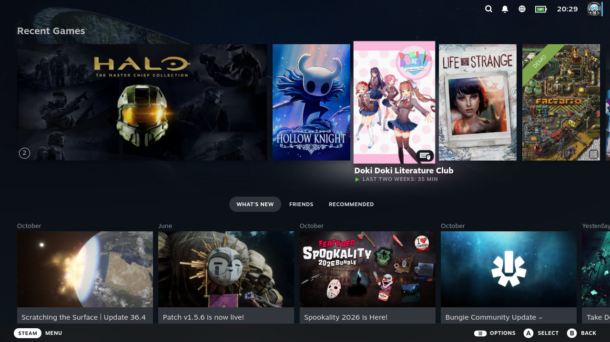
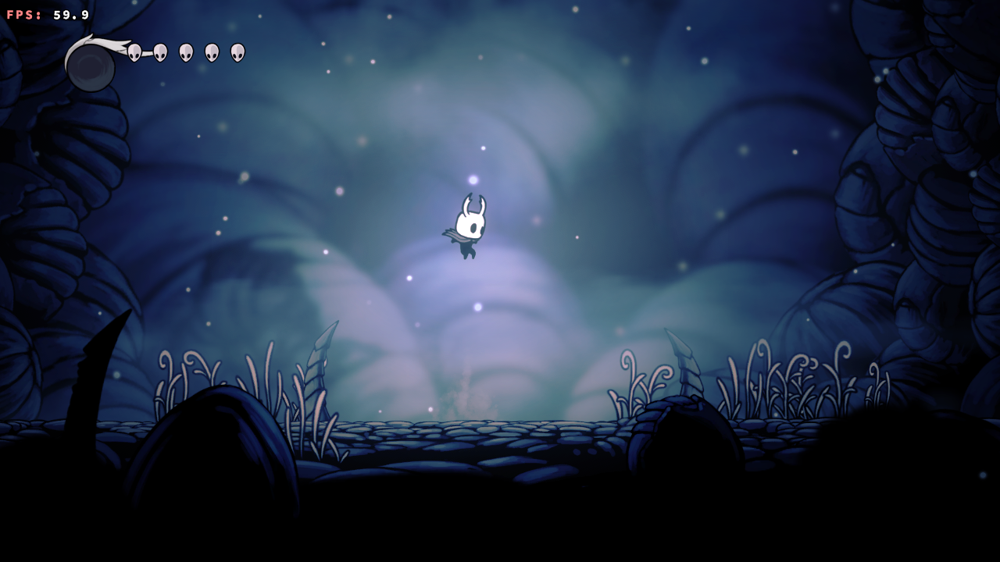
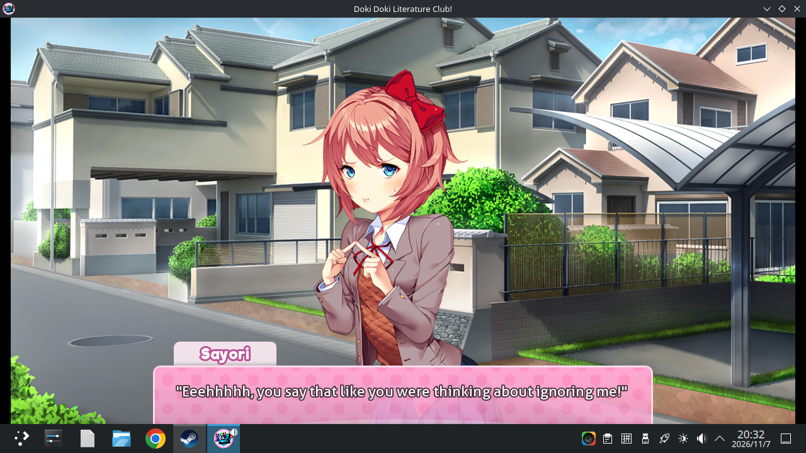

# mtgpu-steam-fex

在 **Ubuntu 24.04 ARM64 + 摩尔线程 M1000（MTGPU）** 上，用 **Steam（linuxarm64 public-beta）
+ FEX-Emu + Proton ARM64** 运行 x86_64 Windows 游戏的完整方案：安装脚本、Steam 兼容工具、
720p Game Mode、独立 Xorg 配置与逐游戏兼容记录。

状态：**可玩**。已实测进入游戏并长时间运行：

| 游戏 | 状态 | 渲染路径 |
|---|---|---|
| Hollow Knight | 720p，59.9 FPS，HUD `MT driver` | arm64 Wine + DXVK 2.3.1 → M1000 原生 Vulkan |
| Doki Doki Literature Club | 720p，原生 OpenGL 4.6 | arm64 Wine + M1000 原生 OpenGL |
| 红警2 / 重聚未来（Reunion Lite） | 720p 窗口，可进任务 | x86_64 Wine + Steam Linux Runtime（见 [Reunion Lite](https://github.com/yeungtuzi/reunion-lite)） |

## 截图

Steam 大屏（720p Game Mode，最近游戏里能看到空洞骑士和 DDLC）：



Hollow Knight，720p，59.9 FPS：



Doki Doki Literature Club，720p：



## 原理：两条运行路径

Steam 客户端是 arm64 原生版，自带 FEX 兼容层。Windows 游戏有两种跑法：

**路径 A：Steam → FEX → x86_64 Proton（对照路径）**

```
Steam(arm64) → FEX 兼容工具 → Steam Linux Runtime sniper(x86_64) → Proton 8(x86_64) → 游戏
```

能启动、能出画面，但 DXVK 在 guest Vulkan loader 里看不到 `VK_KHR_surface`，
回退 `llvmpipe`（6–14 FPS），不满足 GPU 验收。

**路径 B：arm64 Wine + DXVK 2.3.1（当前可玩路径）**

```
Steam(arm64) → M1000ARM64 兼容工具
  → Proton 11 (ARM64) 自带 arm64 Wine（WOW64 跑 x86_64 PE）
  → DXVK 2.3.1 → 宿主 Vulkan → M1000 原生驱动
```

- DXVK 2.7 在 M1000 上报 `No adapters found`，必须用 **2.3.1**；
- Unity 游戏强制全屏而 Xwayland 不能切模式，兼容工具会持续请求 KWin 全屏；
- KWin rootless XWayland 在部分驱动上不映射 Wine 顶层窗口，可用独立 Xorg `:3` 规避；
- SteamAPI 需要 Proton 建的 prefix（`lsteamclient`），所以兼容工具复用 Steam 的前缀。

## 仓库内容

| 路径 | 作用 |
|---|---|
| `scripts/install.py` | 把 Steam(linuxarm64 beta) + FEX + Proton 装进 `/opt/steamos`，系统级写入登记到 `INSTALL-MANIFEST.tsv`，可用 `uninstall.py` 逆操作 |
| `scripts/bootstrap.py` | 首次登录引导（`steam -deckard`），临时停用 x86 binfmt，让 Steam 用自己的 FEX |
| `scripts/setup-m1000.sh` | 安装 `xorg-m1000.conf`、把 DXVK 2.3.1 放进 HK 前缀、可选注入存档 |
| `scripts/steam-compat-tool/` | Steam 兼容工具 `M1000ARM64`：arm64 Wine + DXVK 2.3.1 + 全屏处理 + 按 exe 注入参数 |
| `scripts/game-mode.sh` | Game Mode：切 1280×720@59.97 / scale 1.0，开 Steam 大屏；退出恢复 |
| `scripts/m1000-hotkeyd.py` | Super+Shift+G 退出 Game Mode（evdev） |
| `scripts/run-hk-m1000.sh` | 独立 Xorg `:3` 启动 Hollow Knight（不经 Steam 的调试入口） |
| `scripts/hk-continue.sh` | 点 START GAME → 读存档位 1（新游戏开场会崩，必须读档） |
| `config/xorg-m1000.conf` | M1000 `modesetting` 的 1920×1080 独立 Xorg 配置 |
| `contrib/reunion-lite-qt/` | Reunion Lite 的 Linux/Qt 移植补丁（已合入上游 0.2） |
| `docs/` | 架构、游戏兼容记录、Game Mode、测试与证据索引 |

## 快速开始

> 需要 Ubuntu 24.04 arm64、M1000 驱动与 Vulkan loader、能用的图形会话。
> 所有安装都在 `/opt/steamos` 下，系统级改动只有可逆 symlink 与 binfmt 注册。

```sh
git clone https://github.com/yeungtuzi/mtgpu-steam-fex
cd mtgpu-steam-fex

# 1. 安装 Steam + FEX + Proton 到 /opt/steamos（按提示走）
sudo ./scripts/install.py

# 2. 首次启动 Steam（登录、下载 Proton 11 ARM64 / SteamLinuxRuntime）
./scripts/bootstrap.py

# 3. 准备 M1000 原生 Vulkan 路径（Xorg 配置 + DXVK 2.3.1）
sudo ./scripts/setup-m1000.sh
```

安装兼容工具（在 Steam 里给游戏选 **M1000 ARM64 Wine**）：

```sh
install -d ~/.local/share/Steam/steamapps/compatibilitytools.d/M1000ARM64
cp -rn scripts/steam-compat-tool/* ~/.local/share/Steam/steamapps/compatibilitytools.d/M1000ARM64/
```

Game Mode（720p）：应用菜单里的 **Game Mode - Steam**，或

```sh
/opt/steamos/bin/game-mode start --confirm   # 退出：Super+Shift+G 或 game-mode stop
```

## 已知问题

- **Halo: MCC 暂不可用**：ARM64EC/FEX 路径在 `mcclauncher` 阶段崩溃（`c000001d`），与 EAC 无关。
- DXVK 必须 **2.3.1**；升级到 2.7 会 `No adapters found`。
- Proton Experimental / Proton 11 的 prefix 与 DLL 不要混用，否则 `wineboot` 会坏（`c000007b`）。
- 只在 Ubuntu 24.04 arm64 + M1000 上验证；其它 ARM64 GPU 需要自行确认 Vulkan/DRM。
- 安装脚本会改 `/etc/binfmt.d`、`/usr/share/guestos` 等少量系统路径，均已登记、可卸载。

## 文档

- [架构与两条运行路径](docs/ARCHITECTURE.md)
- [游戏兼容记录](docs/GAMES.md)
- [Game Mode（720p）](docs/GAME-MODE.md)
- [测试与验收](docs/TESTING.md)
- [证据索引](docs/EVIDENCE.md)
- [Gamescope 实验记录](docs/GAMESCOPE.md)
- [Reunion Lite Qt 移植](docs/REUNION-LITE-QT.md)

## 相关项目

- [Reunion Lite](https://github.com/yeungtuzi/reunion-lite)：红警2 / 重聚未来启动器（0.2 起支持 ARM64 Linux）
- [FEX-Emu](https://github.com/FEX-Emu/FEX)：x86_64 用户态模拟
- [Proton](https://github.com/ValveSoftware/Proton)：Steam 的 Wine 发行版
- [vera20k](https://github.com/YuriPlanet/vera20k)：Rust 重写的红警2 引擎

## License

MIT，见 [LICENSE](LICENSE)。`contrib/reunion-lite-qt/` 来自 Reunion Lite（Apache-2.0）。
